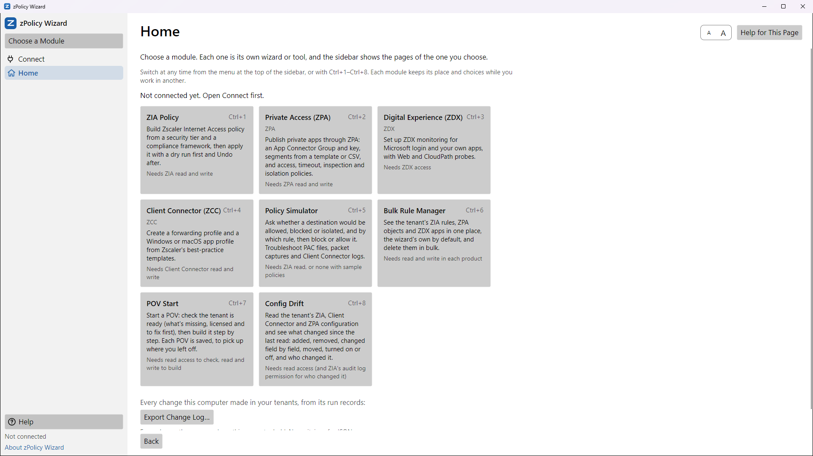

# zPolicy Wizard

zPolicy Wizard is a Mac and Windows app for Zscaler administrators and engineers. It builds best-practice configuration for a Zscaler tenant through Zscaler OneAPI, shows every change before making it, and tests what your policy does to traffic.

zPolicy Wizard isn't an official Zscaler product and isn't supported by Zscaler. It was built by a Zscaler sales engineer for SEs and Zscaler practitioners. Its policy content builds on ZeroTrustPanda's ZTP Policy Wizard and ZTP Policy Simulator, with the author's permission.

**This repository holds no source code.** It hosts the Mac app's downloads (the DMG on each [release](https://github.com/ajawzero/zpolicy-wizard-updates/releases)) and the signed feed the Mac app checks for updates. On Windows, zPolicy Wizard comes from the Microsoft Store.

## What it does

- **Wizards for each product:** Internet Access (ZIA), Private Access (ZPA), Digital Experience (ZDX), Client Connector and AI Guard. Pick a security tier and compliance frameworks, adjust the rules, review the plan, then see a dry run that lists every write before anything changes.
- **Undo:** every change is recorded, and Undo takes it back, newest first, after checking the tenant still matches.
- **Policy Simulator:** ask how a URL, user or app would be handled by your policy and which rule decides, one at a time or in bulk. Its troubleshooting tools: a PAC Analyzer, a Packet Capture Analyzer and a Client Connector log explorer.
- **POV Start and Active POVs:** check a proof-of-value tenant is ready, build the POV step by step, and pick up where you left off.
- **Config Drift:** read a tenant's configuration and see what changed since the last read, field by field.
- **Bulk Rule Manager, Block Page & Logo:** see and delete rules in bulk, and brand the block page.
- **A built-in Guide:** every setting has an ⓘ that explains it, recommends a choice and says where to find it in the Zscaler Admin Console.

## Privacy and safety

- Nothing changes in your tenant without your confirmation. Apply checks the tenant again first and stops on any difference.
- Your OneAPI client secret is kept in the macOS Keychain or Windows Credential Manager, never in a file or log. It's sent only to your tenant's Zscaler sign-in service.
- No account, telemetry or analytics. The app talks to Zscaler's own services, plus the lookups its Simulator tools make when you use them.
- Privacy policy: [privacy.html](https://ajawzero.github.io/zpolicy-wizard-updates/privacy.html).

## Requirements and install

- **Mac:** macOS 15 Sequoia or newer, Apple silicon or Intel. Download the DMG from the [latest release](https://github.com/ajawzero/zpolicy-wizard-updates/releases/latest), open it, and drag **zPolicy Wizard** to **Applications**. It's signed with Developer ID and notarized by Apple. zPolicy Wizard checks for updates daily and asks before installing.
- **Windows:** Windows 10 version 2004 or newer, or Windows 11, on x64 or Arm64, from the [Microsoft Store](https://apps.microsoft.com/detail/9P22CB5ZXH1S). The Store keeps it up to date.
- A Zscaler tenant with OneAPI client credentials (Zscaler Admin Console › Administration › API › API Clients).

## What's in this repository

- `appcast.xml`, served at https://ajawzero.github.io/zpolicy-wizard-updates/appcast.xml: the signed list of versions the Mac app checks for updates, with `appcast.xml.signature`.
- Releases: each version's DMG and its SHA-256. Each download is signed with zPolicy Wizard's own update key and with Developer ID, and the app checks both before installing.
- `privacy.html`: zPolicy Wizard's privacy policy.
